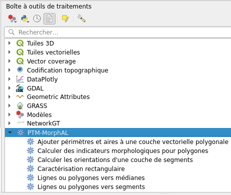

---
hide:
  - navigation
---

# Installation

MorphAL est disponible sous forme d'extension QGIS, déposée dans le dépôt officiel des extensions :<br/>
[https://plugins.qgis.org/plugins/morphal/](https://plugins.qgis.org/plugins/morphal/){target="_blank"}

L'extension requiert QGIS en version 3.4 ou supérieure (jusqu'à la version 3.44.x). Une version compatible avec QGIS 4.x est en cours de développement.

L'installation de MorphAL peut de fait être réalisée directement à partir du ```Gestionnaire d'extensions```. Pour ce faire, cliquez dans un premier temps sur le menu ```Extensions ► Installer/Gérer les extensions```. Dans la fenêtre qui s'ouvre, tapez MorphAL dans la barre de recherche puis cliquez sur ```Installer l'extension```. Si vous souhaitez en savoir plus sur l'installation des extensions QGIS, une page d'aide est disponible [ici](https://docs.qgis.org/latest/fr/docs/training_manual/qgis_plugins/fetching_plugins.html){target="_blank"}.

Une fois l'installation de l'extension terminée, de nouveaux traitements sont maintenant accessibles dans la Boîte à outils de traitements, sous l'intitulé PTM-MorphAL.

<figure markdown>
  { .image-center loading=lazy }
  <figcaption>Menu MorphAL dans la Boîte à outils de traitements</figcaption>
</figure>
